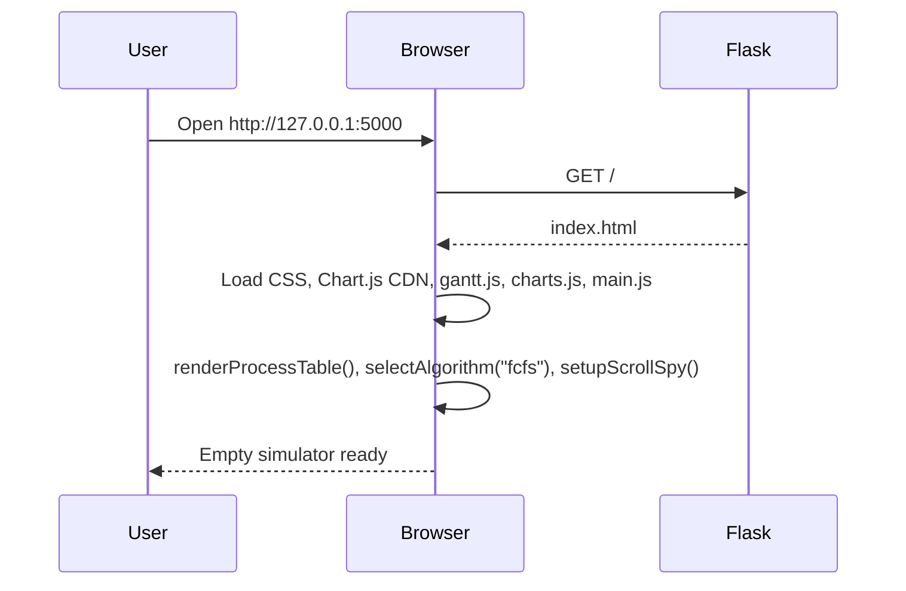
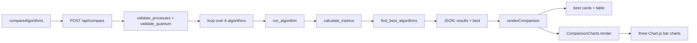
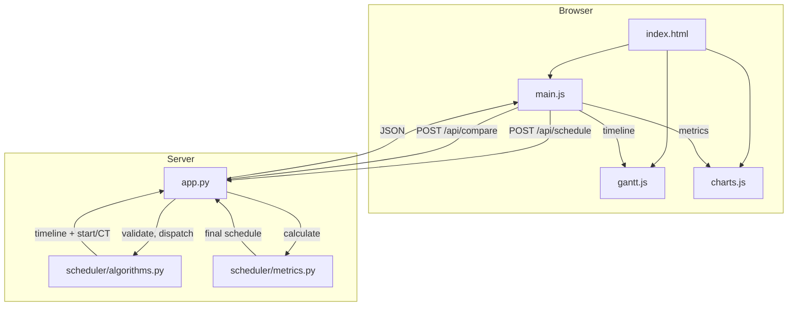
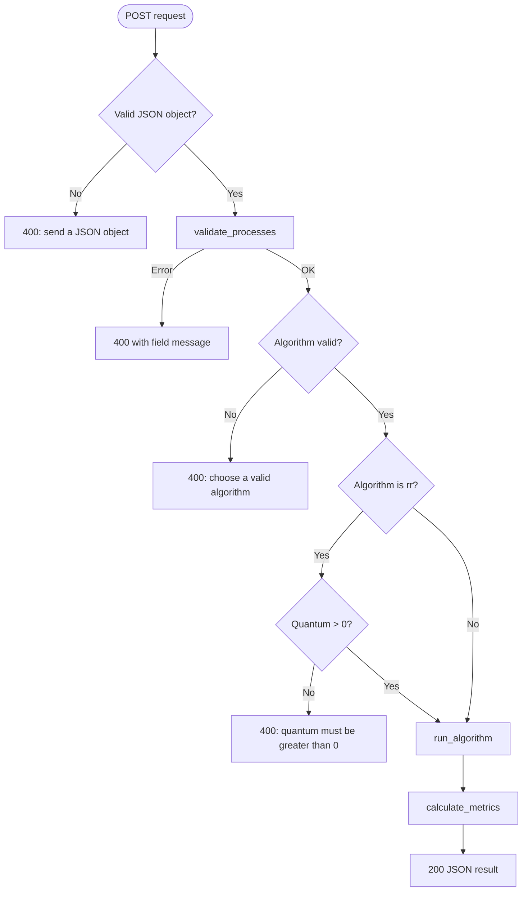
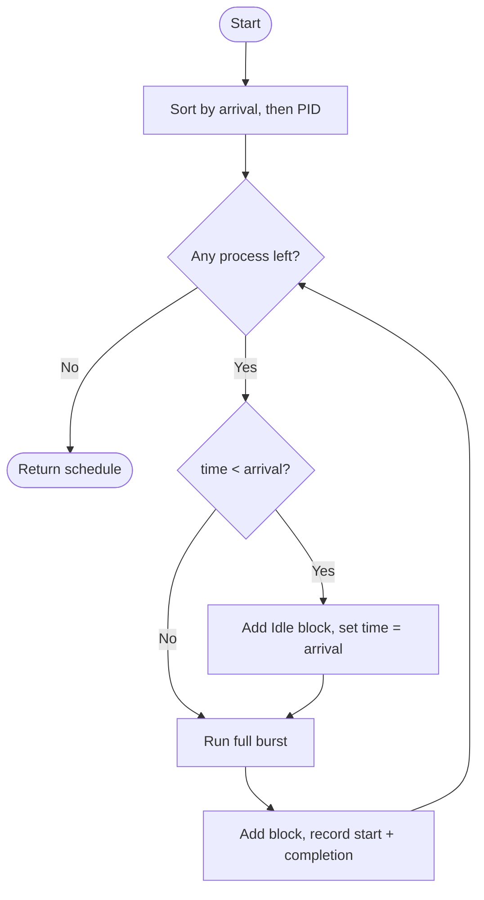
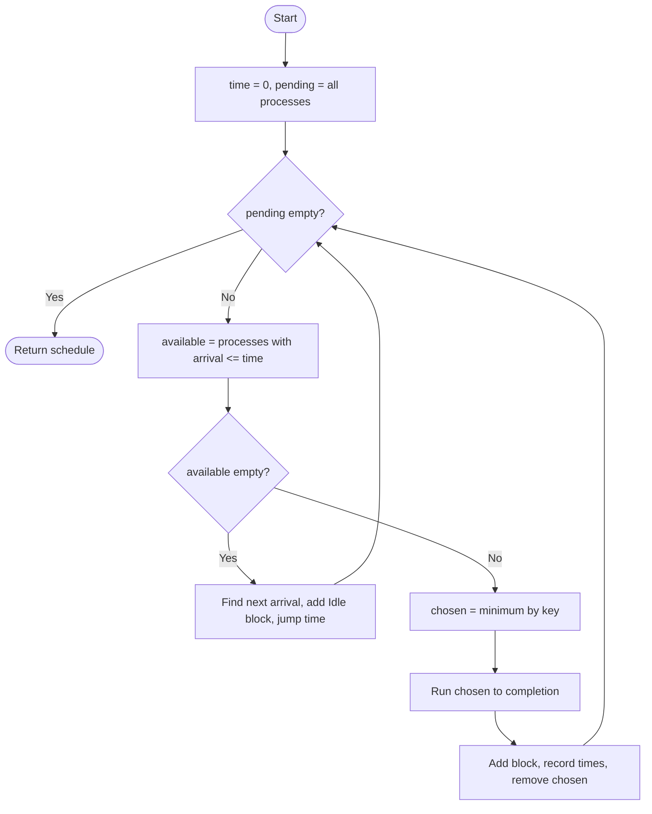
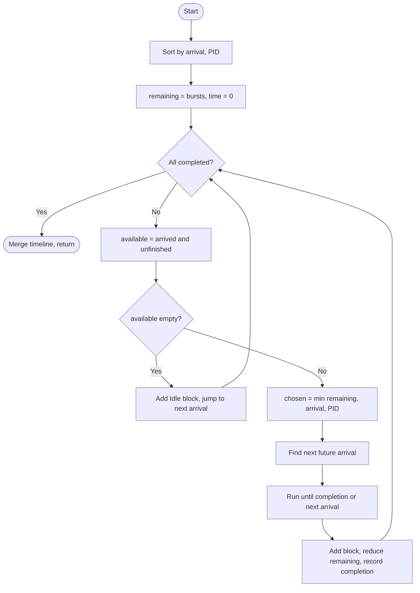
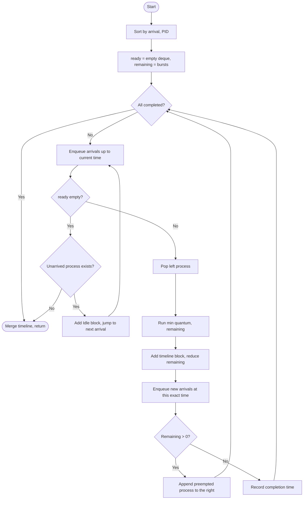
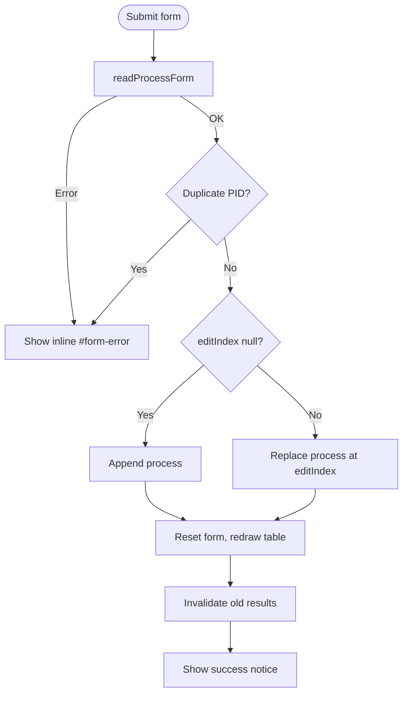
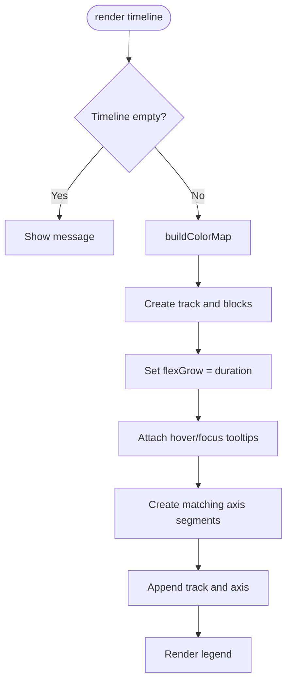

# Code Walkthrough

This document follows a request from the browser to the Python scheduler and back, then shows how each visual is produced. It also contains request/response examples, function call hierarchies and Mermaid flowcharts.

---

## 1. The big picture

The project has three layers:

| Layer | Files | Responsibility |
|---|---|---|
| Presentation | `templates/index.html`, `static/css/style.css` | Structure and appearance |
| Browser logic | `static/js/main.js`, `gantt.js`, `charts.js` | Process list, validation feedback, API calls, rendering |
| Server | `app.py`, `scheduler/algorithms.py`, `scheduler/metrics.py` | Validation, scheduling, metrics, JSON responses |

The browser is **not** trusted to calculate results. It validates input for quick feedback, but the Flask server repeats every check. The server returns the schedule and metrics; the browser only displays them.

```
┌──────────────────────────── Browser ────────────────────────────┐
│ index.html                                                      │
│   ├── style.css                                                 │
│   ├── gantt.js   ── draws timeline blocks                       │
│   ├── charts.js  ── draws Chart.js comparison bars               │
│   └── main.js    ── state, forms, fetch, tables                  │
└───────────────────────────┬─────────────────────────────────────┘
                            │ JSON over HTTP
                            ▼
┌────────────────────────── Flask ────────────────────────────────┐
│ app.py                                                          │
│   ├── validate_processes / validate_quantum                     │
│   └── run_algorithm ──► scheduler/algorithms.py                 │
│                          └── calculate_metrics                   │
│                              scheduler/metrics.py               │
└─────────────────────────────────────────────────────────────────┘
```

---

## 2. Page-load sequence

1. The user runs `python app.py`. Flask starts on `127.0.0.1:5000`.
2. `GET /` calls `index()` and renders `templates/index.html`.
3. The browser loads `style.css`, the Chart.js CDN script, then the local scripts with `defer`.
   - `defer` preserves order, so `gantt.js` and `charts.js` load before `main.js`.
4. `main.js` runs its IIFE:
   - collects DOM elements into `elements`
   - creates the empty `state`
   - attaches event listeners
   - calls `renderProcessTable()` (shows the empty-state row)
   - calls `selectAlgorithm("fcfs")` (selects the FCFS card and hides the quantum field)
   - calls `setupScrollSpy()` (highlights the nav link for the visible section)
5. The initial results and comparison sections show their empty states. No API call is made until the user acts.



---

## 3. Adding a process

```text
User fills PID / arrival / burst / priority
        │
        ▼
handleFormSubmit
        ├── readProcessForm
        │     ├── PID: non-empty, pattern, not "Idle"
        │     └── readIntegerField × 3 (arrival ≥ 0, burst > 0, priority ≥ 0)
        ├── duplicate PID check (case-insensitive, ignoring the row being edited)
        ├── push or replace in state.processes
        ├── showNotice
        ├── resetForm
        ├── renderProcessTable
        └── invalidateResults
```

The process list lives only in `state.processes`. There is no database and no POST to save a process. The list is sent in full with each simulation request.

If validation fails, `handleFormSubmit` catches the `Error` and writes its message into `#form-error` with `textContent`. No browser dialog is used.

---

## 4. Running one algorithm

### 4.1 Browser steps

```text
Click "Run simulation"
        │
        ▼
runSimulation
        ├── state.processes empty? → show #run-error
        ├── selected algorithm is rr? → readQuantum()
        ├── setButtonBusy(run button)
        ├── postJSON("/api/schedule", {processes, algorithm, quantum})
        │
        ├── success → state.lastResult = data
        │              renderResults(data)
        │              scroll to #results
        │
        └── failure → showError(#run-error, message)
```

### 4.2 Server steps

```text
POST /api/schedule
        │
        ▼
api_schedule
        ├── read_request_body           (must be a JSON object)
        ├── validate_processes          (shape, IDs, ranges, duplicates)
        ├── algorithm in ALLOWED_ALGORITHMS?
        ├── if rr: validate_quantum
        ├── run_algorithm
        │     ├── fcfs
        │     ├── sjf
        │     ├── srtf
        │     ├── priority_scheduling
        │     ├── priority_preemptive
        │     └── round_robin
        ├── calculate_metrics
        └── jsonify(result), 200
```

On invalid input the route returns HTTP 400:

```json
{ "error": "Process 'P1': Burst time must be greater than 0." }
```

The frontend reads `data.error` and displays it. There is no HTML error page involved.

### 4.3 Exact API example

**Request:**

```http
POST /api/schedule
Content-Type: application/json

{
  "processes": [
    { "pid": "P1", "arrival": 0, "burst": 3, "priority": 1 },
    { "pid": "P2", "arrival": 2, "burst": 1, "priority": 2 }
  ],
  "algorithm": "fcfs",
  "quantum": null
}
```

**Response (HTTP 200):**

```json
{
  "algorithm_key": "fcfs",
  "algorithm": "FCFS",
  "quantum": null,
  "timeline": [
    { "pid": "P1", "start": 0, "end": 3 },
    { "pid": "P2", "start": 3, "end": 4 }
  ],
  "processes": [
    {
      "pid": "P1",
      "arrival": 0,
      "burst": 3,
      "priority": 1,
      "start_time": 0,
      "completion_time": 3,
      "turnaround_time": 3,
      "waiting_time": 0,
      "response_time": 0
    },
    {
      "pid": "P2",
      "arrival": 2,
      "burst": 1,
      "priority": 2,
      "start_time": 3,
      "completion_time": 4,
      "turnaround_time": 2,
      "waiting_time": 1,
      "response_time": 1
    }
  ],
  "metrics": {
    "process_count": 2,
    "avg_turnaround_time": 2.5,
    "avg_waiting_time": 0.5,
    "avg_response_time": 0.5,
    "cpu_utilization": 100.0,
    "total_time": 4,
    "busy_time": 4,
    "idle_time": 0
  }
}
```

Hand check:

- P1: `TAT = 3 - 0 = 3`, `WT = 3 - 3 = 0`, `RT = 0 - 0 = 0`.
- P2: `TAT = 4 - 2 = 2`, `WT = 2 - 1 = 1`, `RT = 3 - 2 = 1`.
- Averages: `(3+2)/2 = 2.5`, `(0+1)/2 = 0.5`, `(0+1)/2 = 0.5`.
- CPU: busy 4 / elapsed 4 = 100%.

### 4.4 Rendering the response

`renderResults(data)`:

1. Writes the algorithm badge and the four metric cards.
2. Writes the busy/idle/total note and the Gantt total.
3. Calls `window.GanttChart.render(data.timeline, ...)`.
4. Builds one table row per process with `formatCell` so whole numbers stay whole.
5. Reveals `#results-content` and hides the empty state.

---

## 5. Running the comparison

### 5.1 Browser steps

```text
Click "Compare all six"
        │
        ▼
compareAlgorithms
        ├── empty list? → error
        ├── readQuantum()  (always needed because RR is included)
        ├── setButtonBusy
        ├── postJSON("/api/compare", {processes, quantum})
        ├── renderComparison(data)
        └── scroll to #compare
```

### 5.2 Server steps

`api_compare` validates **once**, then loops over `("fcfs", "sjf", "srtf", "rr", "priority", "priority_preemptive")`. Each call goes through `run_algorithm` → `calculate_metrics`. Only `algorithm_key`, `algorithm`, `quantum` and `metrics` are kept. Finally `find_best_algorithms` selects the winners.



### 5.3 Comparison example with the sample workload

**Request:**

```json
{
  "processes": [
    { "pid": "P1", "arrival": 0, "burst": 4, "priority": 2 },
    { "pid": "P2", "arrival": 1, "burst": 3, "priority": 1 },
    { "pid": "P3", "arrival": 2, "burst": 1, "priority": 3 },
    { "pid": "P4", "arrival": 3, "burst": 2, "priority": 2 },
    { "pid": "P5", "arrival": 4, "burst": 5, "priority": 4 }
  ],
  "quantum": 2
}
```

**Actual result values:**

| Algorithm | Avg TAT | Avg WT | Avg RT | CPU util |
|---|---:|---:|---:|---:|
| FCFS | 6.80 | 3.80 | 3.80 | 100.00% |
| SJF | 6.20 | 3.20 | 3.20 | 100.00% |
| SRTF | 6.00 | 3.00 | 2.80 | 100.00% |
| Round Robin (q=2) | 7.60 | 4.60 | 2.40 | 100.00% |
| Priority | 7.00 | 4.00 | 4.00 | 100.00% |
| Preemptive Priority | 7.00 | 4.00 | 3.40 | 100.00% |

**Actual `best` object:**

```json
{
  "avg_turnaround_time": ["SRTF"],
  "avg_waiting_time": ["SRTF"],
  "avg_response_time": ["Round Robin"],
  "cpu_utilization": ["FCFS", "SJF", "SRTF", "Round Robin", "Priority", "Preemptive Priority"]
}
```

The page highlights these cells in green and colours the corresponding chart bars dark green.

### 5.4 Why the winners differ

- SRTF is preemptive SJF: it responds to short arrivals immediately, so it improves on SJF's TAT and WT for this workload (6.00/3.00 versus 6.20/3.20).
- Preemptive Priority has the same TAT/WT as non-preemptive Priority here because P1 and P2 exchange completion positions, leaving the sums unchanged; it improves response time (3.40 versus 4.00) by preempting P1 at t=1.
- Round Robin interrupts long jobs and lets newly arrived processes run sooner → lowest average response time, but more rescheduling and a higher TAT.
- No idle gaps occur, so every algorithm keeps the CPU busy for all 15 time units → all reach 100% utilization.
- Ties are preserved by `find_best_algorithms`, which is why all six appear in the utilization list.

---

## 6. SRTF step-by-step trace

Using the same sample:

| Time | What changes | Decision | Timeline added |
|---:|---|---|---|
| 0 | P1 is the only arrival | Run P1 until the next arrival at 1 | P1 0–1 |
| 1 | P2 arrives with remaining 3; P1 also has 3 left | Ties go to the earlier arrival, so P1 continues | P1 1–2 |
| 2 | P3 arrives with only 1 unit left | P3 is shorter than P1's 2 units → preempt P1 | P3 2–3 |
| 3 | P3 finishes; P4 arrives with 2 units | P1 also has 2 left; P1 arrived earlier → P1 continues | P1 3–4 |
| 4 | P5 arrives; P1 has 1 unit left | P1 is still shortest → run to completion | P1 4–5 |
| 5 | P1 finishes | P4 (2) is shorter than P2 (3) and P5 (5) | P4 5–7 |
| 7 | P4 finishes | P2 (3) is shorter than P5 (5) | P2 7–10 |
| 10 | P2 finishes | Only P5 remains | P5 10–15 |

`merge_timeline` combines P1's two adjacent runs (0–1 and 1–2) into P1 0–2. The final Gantt output is:

```text
P1 [0–2] → P3 [2–3] → P1 [3–5] → P4 [5–7] → P2 [7–10] → P5 [10–15]
```

The two tie situations at t=1 and t=3 are the key implementation detail: SRTF compares remaining time first, then arrival time, then PID.

---

## 7. Preemptive Priority step-by-step trace

Using the same sample (lower priority number = higher priority):

| Time | What changes | Decision | Timeline added |
|---:|---|---|---|
| 0 | P1 is the only arrival | Run P1 until the next arrival at 1 | P1 0–1 |
| 1 | P2 arrives with priority 1; P1 has priority 2 | P2 is strictly higher priority → preempt P1 | P2 1–2 |
| 2 | P3 arrives with priority 3 | P2 (priority 1) remains the best | P2 2–3 |
| 3 | P4 arrives with priority 2 | P2 (priority 1) remains the best | P2 3–4 |
| 4 | P2 finishes; P5 arrives with priority 4 | P1 and P4 both have priority 2; P1 arrived earlier | P1 4–7 |
| 7 | P1 finishes | P4 (priority 2) beats P3 (3) and P5 (4) | P4 7–9 |
| 9 | P4 finishes | P3 (priority 3) beats P5 (4) | P3 9–10 |
| 10 | P3 finishes | Only P5 remains | P5 10–15 |

`merge_timeline` combines P2's three adjacent runs (1–2, 2–3, 3–4) into P2 1–4. The final Gantt output is:

```text
P1 [0–1] → P2 [1–4] → P1 [4–7] → P4 [7–9] → P3 [9–10] → P5 [10–15]
```

The equal-priority decision at t=4 is important: P1 and P4 both have priority 2, so the earlier arrival P1 keeps the CPU.

---

## 8. Round Robin step-by-step trace

Using the sample processes and `q = 2`:

| Time | Action | Ready queue after the action | Timeline added |
|---:|---|---|---|
| 0 | Enqueue P1; run P1 for 2 | `[P2, P3, P1]` | P1 0–2 |
| 2 | Run P2 for 2 | `[P3, P1, P4, P5, P2]` | P2 2–4 |
| 4 | Run P3 for 1 (finishes) | `[P1, P4, P5, P2]` | P3 4–5 |
| 5 | Run P1 for 2 (finishes) | `[P4, P5, P2]` | P1 5–7 |
| 7 | Run P4 for 2 (finishes) | `[P5, P2]` | P4 7–9 |
| 9 | Run P5 for 2 | `[P2, P5]` | P5 9–11 |
| 11 | Run P2 for 1 (finishes) | `[P5]` | P2 11–12 |
| 12 | Run P5 for 2 | `[P5]` | P5 12–14 |
| 14 | Run P5 for 1 (finishes) | `[]` | P5 14–15 |

At time 2, P2 arrived at 1 and P3 arrived at 2. Both are enqueued **before** the preempted P1. The same happens at time 4 for P4 and P5 before P2 is re-added.

The raw timeline ends with P5 12–14 and P5 14–15. `merge_timeline` combines them into P5 12–15, so the page shows 8 blocks.

---

## 9. Module interaction



Important: `algorithms.py` never imports `app.py` or Flask. `metrics.py` imports only `IDLE_PID` from `algorithms.py`. The dependency direction is one-way.

---

## 10. Function call hierarchy

### Single run

```text
runSimulation
├── readQuantum
│   └── readIntegerField
├── postJSON
│   └── fetch
└── renderResults
    ├── formatNumber
    ├── formatCell
    ├── escapeHtml
    └── GanttChart.render
        ├── buildColorMap
        ├── showTooltip (event time)
        │   ├── getTooltip
        │   ├── escapeHtml
        │   └── positionTooltip
        └── renderLegend
            └── createLegendItem

api_schedule
├── read_request_body
├── validate_processes
│   └── parse_int
├── validate_quantum
│   └── parse_int
├── run_algorithm
│   ├── fcfs
│   ├── sjf
│   │   └── _non_preemptive
│   ├── srtf
│   │   └── _preemptive
│   ├── priority_scheduling
│   │   └── _non_preemptive
│   ├── priority_preemptive
│   │   └── _preemptive
│   └── round_robin
│       ├── enqueue_arrivals
│       └── _build_result
│           └── merge_timeline
└── calculate_metrics
```

### Comparison

```text
compareAlgorithms
├── readQuantum
├── postJSON
└── renderComparison
    ├── metricCell
    │   └── formatNumber
    └── ComparisonCharts.render
        ├── destroyCharts
        └── makeChart
            └── isBest

api_compare
├── read_request_body
├── validate_processes
├── validate_quantum
├── for each algorithm: run_algorithm → calculate_metrics
└── find_best_algorithms
```

---

## 11. Flowcharts

### 11.1 Request validation



### 11.2 FCFS



### 11.3 SJF and Priority (shared non-preemptive engine)



`key` is `(burst, arrival, PID)` for SJF and `(priority, arrival, PID)` for Priority.

### 11.4 SRTF



The running process is only interrupted when a new arrival has a strictly smaller remaining time. Equal remaining times keep the earlier-arrived process on the CPU.

### 11.5 Preemptive Priority


The running process is preempted only when a new arrival has a strictly smaller priority number. Equal priority keeps the earlier-arrived process on the CPU. This is the same `_preemptive` engine as SRTF, with a different key.

### 11.6 Round Robin



### 11.7 Frontend add/edit flow



### 11.8 Gantt rendering



---

## 12. Error handling

| Situation | Where it is detected | What the user sees |
|---|---|---|
| Empty process list | `runSimulation` / `compareAlgorithms` and `validate_processes` | Inline message near the action button |
| Negative arrival | `readIntegerField` and `validate_processes` | Inline form/run error |
| Burst 0 | Client and server | "Burst time must be greater than 0." |
| Non-numeric value | Client regex and server `parse_int` | "… must be a whole number." |
| Duplicate PID | Client duplicate check and server `seen_pids` | "Duplicate Process ID …" |
| Reserved `Idle` | Client and server | "… reserved for idle CPU time." |
| Quantum 0 / missing | Client and server | "Time quantum must be greater than 0." |
| Unknown algorithm | `api_schedule` | "Choose a valid algorithm…" |
| Server not running | `fetch` rejection in `postJSON` | "Cannot reach the Flask server…" |
| Chart.js CDN unavailable | `typeof Chart === "undefined"` | Fallback message in each chart box |
| Unexpected server response | `postJSON` | "The server returned an unexpected response." |

The server never returns a traceback to the page for expected validation errors. Unexpected programming errors still use Flask's normal error handling, which is useful during development.

---

## 13. Results invalidation

Stale results are a common bug in interactive calculators. This project avoids them by calling `invalidateResults()` whenever the inputs change:

- adding, editing or deleting a process
- loading the sample
- clearing the list
- changing the selected algorithm
- editing the quantum

`invalidateResults()` hides both result sections, clears `lastResult` / `lastComparison`, and hides errors. The user must run again. This is intentionally simple and safe.

---

## 14. Statelessness and concurrency

The server does not store the process list. Every request contains all processes, and every response is computed from scratch. Consequences:

- Two browser tabs cannot interfere with each other.
- Restarting Flask loses nothing because there is nothing stored.
- Refreshing the page clears the browser state.
- No database, login, session or migration is required.

Flask's development server is single-process by default, but even with multiple workers the design is safe because there is no shared mutable server state.

---

## 15. Complexity

| Operation | Complexity | Reason |
|---|---|---|
| FCFS | `O(n log n)` | Sort by arrival/PID, then one pass. |
| SJF | `O(n²)` | Up to `n` rounds, each scans the pending list. |
| SRTF | `O(n²)` | At most `O(n)` events; each event scans the available list. |
| Priority | `O(n²)` | Same shared non-preemptive engine as SJF. |
| Preemptive Priority | `O(n²)` | At most `O(n)` events; each event scans the available list. |
| Round Robin | `O(n + S)` | Each process enters once; `S` is the number of time slices, at most `sum(burst)/quantum + n`. Deque operations are O(1). |
| `merge_timeline` | `O(B)` | One pass over timeline blocks. |
| `calculate_metrics` | `O(n + B)` | One pass over processes and timeline. |
| Gantt rendering | `O(B)` DOM nodes | One block + one axis segment per timeline block. |

For a teaching simulator with at most 100 processes, these costs are negligible. SJF, SRTF, Priority and Preemptive Priority use the simple scan-based implementation because it is easier to explain than a heap.

---

## 16. How to debug the running project

1. **Flask terminal:** every request is logged with method, path and status.
2. **Browser DevTools → Console:** look for JavaScript errors.
3. **Browser DevTools → Network:** inspect the `/api/schedule` request and response JSON.
4. **Python shell:** test an algorithm directly:
   ```python
   from scheduler.algorithms import round_robin
   from scheduler.metrics import calculate_metrics
   print(calculate_metrics(round_robin(
       [{"pid": "P1", "arrival": 0, "burst": 4, "priority": 1}], 2
   )))
   ```
5. **Tests:** `python -m pytest -v` pinpoints which rule broke.
6. **Port conflict:** if port 5000 is busy, change the port in the last line of `app.py`.

---

## 17. Test execution flow

`tests/test_algorithms.py` adds the project root to `sys.path`, imports the pure modules and the Flask app, then runs three kinds of tests:

1. **Pure algorithm tests** - call `fcfs`, `sjf`, `srtf`, `preemptive_priority`, `round_robin`, etc. directly and compare timelines and metrics.
2. **Metric/comparison tests** — check averages, utilization and tie handling in `find_best_algorithms`.
3. **API tests** — use `app.test_client()` to POST JSON and assert status codes and error messages.

The actual final run is:

```text
$ python -m pytest -q
57 passed in 0.55s
```

Timing varies slightly by machine.

The tests do not start a real network server; the separate live HTTP check used during development did (GET `/`, POST `/api/schedule`, POST `/api/compare`, and invalid requests), and its results are recorded in `TEST_CASES.md` and the project report.
